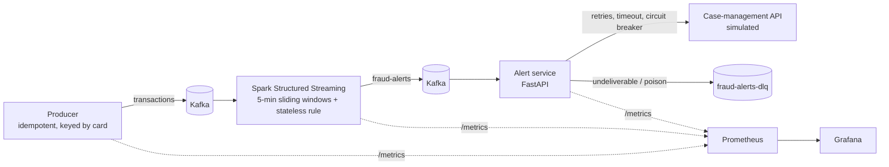

# FraudStream: real-time card-fraud detection with Kafka, Spark and Prometheus

A small, production-style streaming pipeline. Simulated card transactions flow through **Kafka**. A **Spark Structured Streaming** job scores them against fraud rules over sliding windows. A **FastAPI** alert service turns the alerts into investigator cases and is built to keep working when things fail. Every stage reports to **Prometheus**, with a **Grafana** dashboard and alert rules on top.



## Run it

Requires Docker Desktop (about 4 GB of RAM free).

```bash
make up        # docker compose up -d --build   (first start downloads the Spark-Kafka connector)
make logs
```

| What | Where |
|---|---|
| Grafana dashboard | http://localhost:3000 (opens on the FraudStream dashboard) |
| Prometheus + alert rules | http://localhost:9090/alerts |
| Alert service API | http://localhost:8000/alerts, `/health`, `/ready`, `/docs` |
| Spark UI | http://localhost:4040 |

**Failure demo:** `make chaos` makes the case API fail 60% of the time. On the dashboard, retries go up, the circuit breaker opens, alerts move to the dead-letter queue, and the `CircuitBreakerOpen` alert fires. `make calm` puts the failure rate back, and the breaker closes again on its own. `make dlq` shows what got parked.

**Tests:** `pip install -r requirements.txt && make test`. This runs 25 tests and needs Java 17+, because the Spark transforms are tested with a local Spark session.

## What each part does

**Producer** (`producer.py`)
- Generates about 20 transactions a second across 10,000 cards. About 1% are fraud patterns: card testing (velocity), a cloned card used in several countries, account takeover (high spend), and cash-out at high-risk merchants.
- Messages are keyed by `card_id`, so each card's events stay in order on one partition.
- Uses `enable.idempotence` and `acks=all`, so a producer retry never writes a duplicate.

**Spark job** (`stream_job.py`, `spark_transforms.py`)
- **Stateful query:** groups each card's transactions into 5-minute windows that slide every minute. It uses a 2-minute watermark to handle late events and RocksDB to store the window state, and outputs in update mode.
- **Stateless query:** a per-transaction rule for large card-not-present purchases at high-risk merchants.
- **Single source for the rules:** they're defined once in `rules.py` and used by both Spark and plain Python. Tests check that Spark and Python produce the same alert IDs.
- **Back-pressure** with `maxOffsetsPerTrigger`, and checkpoints so a restarted job resumes from where it stopped.
- Writes Spark's own progress numbers (input rate, processed rate, trigger time, state size) as Prometheus metrics.

**Alert service** (`alert_service.py`, `resilience.py`)

| Pattern | Why it's needed here |
|---|---|
| Idempotency (SQLite, deterministic `alert_id`) | Spark update mode re-sends a window each time its count grows, and Kafka delivers at least once. |
| Per-card cooldown | Sliding windows overlap, so one fraud burst trips up to five windows. Investigators should get one case, not five. |
| Retries with exponential backoff and jitter, per-call timeout | Brief API errors shouldn't drop alerts. |
| Circuit breaker (closed → open → half-open) | When the downstream API is down, fail fast instead of piling up retries. |
| Dead-letter queue | Alerts that can't be delivered, and malformed messages, are kept for replay. They don't stop the stream. |
| Manual offset commit after handling | No alert is lost if the service crashes partway through. |
| `/health` vs `/ready` | Liveness (the consumer thread is running) is separate from readiness (partitions are assigned and the breaker isn't open). |

Logs are structured JSON, with fields like `alert_id`, `card_id` and `rules` that you can search on.

## Observability

**Service-health indicators** (all on the Grafana dashboard):
- Throughput: transactions/sec produced vs. processed by Spark
- Latency: p95 time from detection to case creation, and p50/p99 alert-handling time
- Errors: retries, dead-letter rate, circuit-breaker state
- Saturation: Spark trigger duration, number of rows in streaming state, consumer lag
- Quality: alert precision, measured against the simulator's ground-truth labels. The rules never see these labels.

**Prometheus alert rules** (`monitoring/alert_rules.yml`): `ServiceDown`, `SparkQueryStopped`, `SparkFallingBehind`, `CircuitBreakerOpen`, `DeadLetterRateHigh`, `DetectionLatencyHigh`, `ConsumerLagGrowing`.

## Results (local streaming run, 4 micro-batches, about 10k transactions)

| | |
|---|---|
| Fraud cards injected | 181 |
| Raw alerts from Spark | 863 |
| Removed as duplicates (idempotency) | 120 |
| Suppressed (overlapping windows, same card) | 562 |
| **Cases created** | **181** (one per fraud card) |
| Precision / recall vs. ground truth | 1.00 / 1.00 |

So 863 raw alerts became 181 cases, with none missed. The perfect scores come from synthetic data with clear-cut patterns; real fraud is much noisier. The point of this project is the engineering around the model: the pipeline, the reliability patterns and the monitoring.

## Runbook

<a id="runbook-servicedown"></a>**ServiceDown:** run `docker compose ps` and `docker compose logs <service>`. The Spark job exits non-zero when a query dies, and the restart policy brings it back from its checkpoint.

<a id="runbook-circuitbreakeropen"></a>**CircuitBreakerOpen:** the case API is failing. Alerts aren't lost; they're in `fraud-alerts-dlq` (`make dlq`). The breaker probes again every 30 s and closes on its own. Once it's healthy, replay the DLQ.

**SparkFallingBehind:** check the trigger duration and state rows. Either increase `maxOffsetsPerTrigger` and the partition count, or shorten the window.

## Next steps
- A DLQ replay job
- An ML score (for example the XGBoost model) alongside the rules
- Schema Registry with Avro
- OpenTelemetry tracing across producer → Spark → service
- A Kubernetes deployment with liveness and readiness probes
